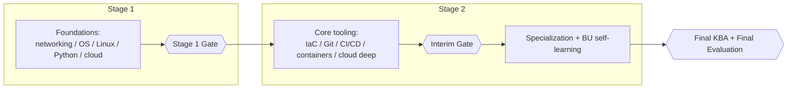
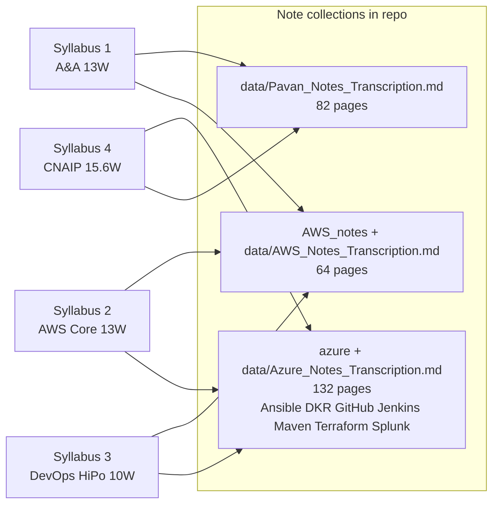

# Curriculum Maps — Master Overview

Four training syllabi (NIIT/Cognizant GenC delivery track), extracted and linked module-wise.
Each detailed map lives next to this file:

| # | File | Track | Weeks | Hours | Flavor |
|---|------|-------|-------|-------|--------|
| 1 | `01_Automation_and_Analytics_13W.md` | Automation and Analytics | 13 | 589 | IT basics → cloud (Azure+AWS) → scripting → GenAI stack → ops/ITSM → service desk |
| 2 | `02_AWS_Core_Basics_and_Advanced_13W.md` | AWS Core — Basics & Advanced (Standard, NIIT) | 13 | 585 | Deep single-cloud AWS + vanilla DevOps chain (Terraform/Git/Jenkins/Docker/K8s) |
| 3 | `03_CIS_AWS_DevOps_HiPo_10W.md` | CIS AWS DevOps — HiPo (NIIT) | 10 | 450 | Compressed DevOps: AWS serverless/event-driven + Python automation + vanilla DevOps + containers-on-AWS + Bedrock |
| 4 | `04_CIS_CNAIP_DevOps_via_AWS_15.6W.md` | CIS CNAIP — DevOps via AWS | 15.6 | 700.5 | Longest classics: OS/scripting → full AWS surface → DevOps toolchain (Jenkins/Ansible/Maven/Splunk/Jira) → EKS/ECS/DOP-C02 |

All four gate on the same criteria: **"A" (GREEN as PHS) in the Final Evaluation**, split into Stage 1 and Stage 2 with interim assessments.

---

## 1. One spine, four flavors — the shared skeleton

Every syllabus follows the same shape: **Foundations → Core tooling → Specialization → Gates**, with Stage-1 assessment as the doorway into Stage 2, and an interim KBA + technical evaluation at mid-point:

**BU-mandatory self-learning (identical set in all four, learned on your own time during Stage 2):**
GenAI Fundamentals (ELRNG01863) → GenAI quick assessment (ATHDW335105) → Responsible AI (CGZ-914en + ELRNG02344) → Flowsource (ELRNG02089) → Prompt Engineering Foundation (PY0009562, CNAIP only) → GitHub Copilot (MS Learn + Udemy + tutorials) → AI Agents (PY0010995, KBA ≥70% → PL1) → ITIL 4 Udemy set + ServiceNow ITSM + K-point recordings (INC / SR / CHNG) → Behavioral training (39h) + BU Mentor Connect.

---

## 2. Module-wise cross-school mapping — who teaches what, and where it sits in the order

| Topic | A&A (13W) | AWS Core (13W) | DevOps HiPo (10W) | CNAIP (15.6W) |
|-------|-----------|----------------|---------------------|---------------|
| Networking fundamentals | **Stage 1, #1 (8h)** — the starting module | (assumed; DNS depth in Stage 2) | (assumed) | (assumed inside M1 cloud fund.) |
| Linux / OS | Stage 1 #2–3 | Linux basics inside Stage 1 fund. | — | **M1 (55h): Linux Admin + shell scripting** |
| Python | Stage 1 (36h) → Stage 2 (52h) | Stage 2 (36h) | **Day 3–6 (36h), then Boto3** | **M1**, reused everywhere |
| Databases / DBA | Stage 1 (16h) | RDS + DynamoDB (90h, Stage 2) | — | RDS/ElastiCache in M2 |
| Security (CIA, encryption) | Stage 1 (8h) | KMS/ACM (Stage 2) | — | KMS/SSM (M2) |
| Cloud fundamentals | Stage 1 (64h, Azure+AWS) | Stage 1 (90h AWS) | 2-day recap | M1 cloud fund. + M2 (68h AWS) |
| VPC/EC2/S3/IAM deep | inside CF | Stage 1 + Stage 2 | recap | M2 |
| Cost optimization / Route 53 | inside pricing topics | **62h dedicated module (Stage 2 first)** | — (Route 53 preview) | Route 53 in M2 |
| Messaging (SNS/SQS) | Lambda/SQS in CF | Other PaaS 30h (Stage 2) | **24h event-driven + EventBridge** | SQS/SNS/Kinesis (M2) |
| Serverless (Lambda/API GW/Step Fn) | preview | Lambda + API GW (Stage 2) | **core: 3 modules + Glue ETL** | Lambda/API GW/Cognito/SAM (M2) |
| Containers (Docker) | — | Docker Essentials 15h | **Docker 27h + ECR** | Docker in common-specialized |
| Kubernetes | — | K8s Overview 36h | **K8s 36h → EKS 27h** | K8s fundamentals → EKS/ECS sessions 1–7 |
| ECS/Fargate | — | — | **ECS+Fargate 24h** | ECS/ECR/Fargate (M2) + M5 deep dive |
| Terraform / IaC | 8h awareness only | **27h** | 27h | common-specialized |
| Git | — | 8h | in Git&Jenkins 27h | GIT fundamentals |
| Jenkins / CI/CD CD | — | 18h | 27h | **205h core incl. Maven/Gradle/Ansible/Jira** |
| Ansible | — | (outcome sheet only) | — | **ILT core module** |
| Splunk / Jira / monitoring | Observability & AIOps 40h | CloudWatch/Config | CloudWatch glue labs | Splunk + Jira + troubleshooting |
| ITSM / Service desk / DWP | **40h + 24h + ITIL (end chain)** | ITIL self-learn | ITIL self-learn | ITIL self-learn |
| GenAI platform (Foundry/Vertex/Bedrock) | **Cloud Native GenAI 48h** | — | Bedrock+SageMaker 27h | — |
| AI modernization | AIOps advanced | — | **AWS Transform/ATX** | — |
| Cert prep | — | — | — | **CLF-C02 / DVA-C02 / DOP-C02** |

**Learning-order guardrail (the question you raised):** inside every syllabus you never jump — the order always runs *early-stage skills → their application*, and later modules explicitly reuse earlier ones:
- A&A: Networking→…→Service Desk is the exact sheet order; Service Desk is the LAST stage-2 module on purpose (it depends on ITSM, which depends on observability/AIOps, which depends on cloud + scripting).
- AWS Core: Elasticity → Cost/DNS → IAM+DB → Terraform → PaaS → Git→Jenkins→Docker→K8s — each module consumes the previous (Terraform needs IAM/VPC knowledge; K8s needs Docker; CloudWatch/ALB feed the ASG labs).
- HiPo: recap → Python → Terraform → Git→Jenkins→Docker→K8s → ECR→ECS→EKS → Bedrock — one Docker-to-EKS ladder.
- CNAIP: Linux/Python/Shell → AWS surface → CCL labs → DevOps toolchain → EKS/ECS/DOP-C02 — OS before cloud, cloud before tooling, tooling before platform specialization.

When you "come back" to a module to revise, use the detailed maps: each one lists its globals with links back to the three note collections.

---

## 3. Connecting the syllabi to the three note collections (what you can revise, where)

Coverage summary:

- **Pavan notes (82 pgs)** — follows Syllabus 1 (A&A) almost exactly: networking p.1–7 → OS/Linux p.5–12 → GitHub/TCP/DNS/VPN p.12–21 → cloud Azure/AWS p.22–36 → DBA p.37–43 → security p.44–47 → scripting/REST/Terraform p.45–60 → prompt eng/LLM/LangChain/RAG/vector DBs p.66–82. Gaps: AIOps, ITSM/DWP, ITIL detail, Foundry/Vertex, MCP, AI Agents, Copilot.
- **AWS notes (64 pgs)** — Cloud Practitioner (43 pgs) + Notes (18) + EventBridge (3): serves Syllabus 2 Stage 1, HiPo recap/messaging, CNAIP M2.
- **Azure/DevOps notes (132 pgs across 7 tool PDFs)** — serves CNAIP M4 (Ansible/GitHub/Jenkins/Maven/Splunk) and the vanilla-DevOps chain in Syllabi 2 & 3 (Git/Jenkins/Docker/K8s/Terraform).

Cross-checked in each detailed map: a "Notes coverage" table per syllabus lists exactly what to revise where, and flags what is **missing from notes** entirely.

---

## 4. What is NOT covered by any existing notes (candidate areas to write notes next)

| Area | Appears in |
|------|-----------|
| Route 53 deep (failover, resolver, hybrid) | Syllabus 2 |
| ACM/KMS, DynamoDB detail | Syllabus 2, 4 |
| Step Functions, AWS Glue/Data Catalog | Syllabus 3 |
| ECS/EKS production depth (IRSA, CSI, Karpenter, LB controller) | Syllabi 3, 4 |
| Bedrock / SageMaker / AWS Transform | Syllabus 3 |
| Cloud Native GenAI platforms (Azure Foundry, Vertex AI), MCP | Syllabus 1 |
| Observability & AIOps, OpenTelemetry/Jaeger/Prometheus/Grafana | Syllabus 1 |
| ITSM processes / DWP & Service Desk / ITIL detail / SNOW | Syllabus 1, self-learn everywhere |
| Ansible / Maven / Jira / Splunk depth | Syllabus 4 (Ansible/Maven/Splunk notes exist; Jira/SRE missing) |
| Boto3 automation | Syllabus 3 |
| Copilot / Flowsource / AI Agents | All (self-paced) |
