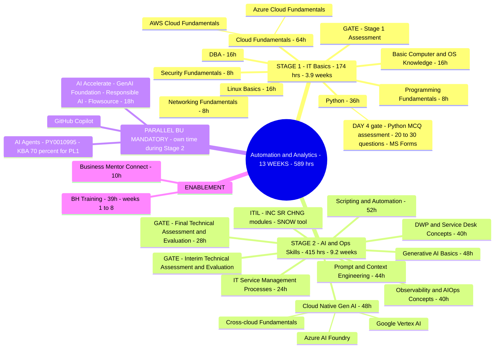

# Syllabus 1 — Automation and Analytics (13 WEEKS)

> Source: `Automation and Analytics  - Curriculum - 13 WEEKS .xlsx`
> Track: Automation and Analytics | Category: Technical + Behavioral | Audience: PT\PAT
> Gate: **"A" GREEN as PHS in Final Evaluation**
> Total: **589 hrs / ~65 days / 13 weeks**

---

## 1. Overall Shape (mermaid mindmap)

---

## 2. Learning Sequence — module-wise flow (what comes NEXT, in order)

```mermaid
flowchart LR
  A[Networking Fundamentals 8h] --> B[Basic Computer and OS 16h]
  B --> C[Linux Basics 16h]
  C --> D[Programming Fundamentals 8h]
  D --> E[Python 36h]
  E --> G1{{Python MCQ gate - end of Day 4}}
  G1 --> F[DBA 16h]
  F --> G[Security Fundamentals 8h]
  G --> H[Cloud Fundamentals 64h - Azure then AWS]
  H --> I{{STAGE 1 ASSESSMENT - gate}}
  I --> J[Scripting and Automation 52h]
  J --> K[GenAI Basics 48h]
  K --> L[Prompt and Context Engineering 44h]
  L --> I2{{INTERIM ASSESSMENT and EVALUATION}}
  I2 --> M[Cloud Native Gen AI 48h]
  M --> N[Observability and AIOps 40h]
  N --> O[ITSM Processes 24h]
  O --> P[DWP and Service Desk 40h]
  P --> Q[ITIL plus SNOW self-paced]
  Q --> R{{FINAL TECHNICAL ASSESSMENT and EVALUATION}}
```

**Reading of the flow (the important part):**
- You do NOT jump from Networking straight to Service Desk. The spine is:
  `Networking → OS → Linux → Programming → Python → DBA → Security → Cloud (Azure, AWS) → [Stage 1 gate] → Scripting/Automation → GenAI → Prompt Engineering → [Interim gate] → Cloud-Native GenAI → Observability/AIOps → ITSM → Service Desk → ITIL → [Final gate]`
- **You come BACK to earlier skills** — this curriculum is spiral, not linear:
  - Python: learned in Stage 1 (36h) → deepened in Stage 2 "Scripting & Automation" (52h) and reused in REST API / CLI / IaC hands-on and in AIOps anomaly-detection lab.
  - Networking: learned in Stage 1 → reused inside Linux (ping/netstat/traceroute), cloud networking (VNets, VPC, VPN Gateway, ExpressRoute, Route 53) and observability (traces across microservices).
  - OS/Linux: Stage 1 basics → CLI usage in Stage 2 (Azure CLI / AWS CLI / gcloud).
  - Databases: Stage 1 DBA → Azure SQL / Cosmos DB / RDS / DynamoDB inside Cloud Fundamentals.
  - Security: Stage 1 fundamentals → Azure Defender/NSG, AWS IAM/KMS inside Cloud Fundamentals; compliance topics.

---

## 3. Stage 1 — Information Technology Basics (174 hrs / 3.87 weeks, "Skill" level)

| # | Module | Hrs | Topics | After it comes |
|---|--------|-----|--------|----------------|
| 1 | Networking Fundamentals | 8 | OSI and TCP/IP models; IP addressing, ports, routing basics (CCNA / Network+ level); DHCP, DNS, NAT/PAT | Basic Computer & OS |
| 2 | Basic Computer & OS Knowledge | 16 | Windows Server 2019/2022/2025; hardware, OS install & management; command line | Linux Basics |
| 3 | Linux Basics | 16 | RedHat or Kali; commands, permissions, file system navigation; ping, netstat, traceroute | Programming Fundamentals |
| 4 | Programming Fundamentals | 8 | Basic scripting in Python or Bash; control structures, functions, error handling | Python |
| 5 | Python (+ assessment) | 36 | — plus **Day-4 Python MCQ assessment (20–30 Qs, MS Forms)** — coach must ensure concepts covered | DBA |
| 6 | DBA | 16 | Database fundamentals & architecture; DBA tasks; advanced DBA ops | Security Fundamentals |
| 7 | Security Fundamentals | 8 | CIA triad; phishing/malware/DoS; encryption basics | Cloud Fundamentals |
| 8 | Cloud Fundamentals | 64 | **Azure**: concepts, core services, architecture, security/privacy/compliance, pricing/SLA/lifecycle, management/monitoring. **AWS**: same skeleton — concepts, core services, architecture, security & compliance, pricing & support, monitoring & management | Stage 1 Assessment |
| — | **Stage 1 Assessment** | 2 | Gate to Stage 2 | Scripting & Automation |

Assured level out of Stage 1: Networking = **Skill**; everything else = **Knowledge**.

### 3a. Azure Cloud Fundamentals (32h inside the 64h block)
Order: Cloud Concepts (4h) → Core Azure Services (12h): VMs/App Services/Containers/Functions, VNets/LB/VPN GW/ExpressRoute, Blob/File/Queue/Disk, Azure SQL/Cosmos DB, Azure AD/RBAC → Architecture (4h): Regions/AZs/Resource Groups, Subscriptions/Management Groups, ARM, portal+CLI deploy → Security (4h): Security Center, NSGs, ISO/GDPR/HIPAA, Policy/Blueprints → Pricing/SLA/Lifecycle (4h): calculators, cost mgmt → Management & Monitoring (4h): Azure Monitor, Log Analytics, App Insights, Service Health/Advisor + hands-on alerts.

### 3b. AWS Cloud Fundamentals (32h inside the 64h block)
Order: Cloud Concepts (4h) + global infra (Regions/AZs/Edge) → Core AWS Services (12h): EC2/Beanstalk/Lambda, VPC/Route 53/ELB/CloudFront, S3/EBS/EFS/Glacier, RDS/DynamoDB/Aurora, IAM+MFA → Architecture (4h): accounts/organizations, HA/FT, elasticity + Lab: EC2 + VPC + storage → Security & Compliance (4h): shared responsibility, IAM best practice, SG vs NACL + Lab: IAM roles → Pricing & Support (4h): pay-as-you-go/reserved/spot, calculator, support plans → Monitoring (0.5h listed): CloudWatch, CloudTrail, Trusted Advisor + lab.

---

## 4. Stage 2 — AI, Automation and Ops (415 hrs / 9.22 weeks)

| # | Module | Hrs | Topics / sequence | Gates |
|---|--------|-----|-------------------|-------|
| 1 | Scripting & Automation | 52 | Intro (4h) → Python fundamentals (12h) → REST APIs (8h) → CLI (Azure/AWS/gcloud) (8h) → IaC awareness (Terraform/ARM/CloudFormation) (8h) → Integration & automation end-to-end (8h) → Best practices (4h) | — |
| 2 | Generative AI Basics | 48 | Intro (4h) → LLMs: transformers, attention, GPT/Gemini/LLaMA/Claude (8h) → RAG: retriever + generator, LangChain pipeline (8h) → Agentic AI & frameworks: LangChain chains/agents, Azure ADK (12h) → Vector DBs: embeddings, Pinecone/Weaviate/FAISS/Azure Cognitive Search (8h) → MCP (4h) → Prompt & context engineering intro (4h) | — |
| 3 | Prompt & Context Engineering | 44 | Intro (4h) → Design strategies: zero/one/few-shot, chain-of-thought (8h) → Context engineering (8h) → Advanced: role prompting, multi-turn, chaining (8h) → Evaluation & optimization (4h) → Framework integration: LangChain, RAG pipelines, Azure AI SDKs (8h) → Future: automated prompting, MCP (4h) | **Interim Technical Assessment + Interim Evaluation (18h)** |
| 4 | Cloud Native Gen AI | 48 | Azure AI Foundry (4h intro, 8h concepts, 8h prompting, 8h fine-tuning, 8h deployment, 4h observability, 8h advanced RAG/agentic) **+** Google Vertex AI (same 7-step skeleton: Studio → Gemini → prompting → fine-tuning → BigQuery/Dataflow integration → monitoring → RAG) **+** merged "Cloud Native AI Fundamentals" view (26h sheet that pairs Azure vs Google topic-by-topic) | — |
| 5 | Observability & AIOps | 40 | Intro: monitoring vs observability, metrics/logs/traces (4h) → Tools: Prometheus, Grafana, ELK, Azure Monitor, CloudWatch + dashboards (8h) → AIOps: anomaly detection, event correlation, predictive analytics (8h) → Cloud-native observability: microservices, OpenTelemetry/Jaeger (8h) → Integration: AIOps feeding, automated remediation, MTTR (4h) → Advanced: GenAI workload observability, ML-based monitoring (8h) | — |
| 6 | IT Service Management Processes | 24 | ITIL framework + service lifecycle (4h) → Core processes: Incident, Problem, Change, Release, Service Request (4h) → Service catalog & SLA/OLA (4h) → Workflow automation: ServiceNow, Jira SM, BMC Remedy (4h) → Tools & platforms (4h) → Advanced: cloud-native ITSM, AIOps integration, AI service desk (4h) | — |
| 7 | DWP & Service Desk Concepts | 40 | Digital workplace intro (4h) → End-user computing: Intune/SCCM/Workspace ONE, VDI/DaaS (8h) → Service desk concepts: desk types, ticket lifecycle (8h) → Workflows: incident mgmt, request fulfillment, escalation (8h) → Automation & self-service: portals, chatbots (4h) → Metrics: FCR, MTTR, SLA compliance (4h) → Future: AI service desk, DEX, AIOps integration (4h) | — |
| 8 | ITIL Concepts (INC, SR, CHNG + SNOW) | NA | Self-paced Udemy: ITIL 4 intro, measures & metrics, ITIL 4 Foundation exam prep, ServiceNow ITSM processes + K-point Day 1/Day 2 recordings + 90-min SME session | **Final Technical Assessment (1h) + Final Technical Evaluation (27h)** |

Total for stage-2 gated end: Stage 2 Final Assessment 1h + Qualifier/Evaluation 27h.

## 4a. Parallel BU-Mandatory track (learnt on your OWN time, must finish by end of Stage 2)

- **AI Accelerate + GitHub Copilot (18h)** — GenAI Foundation (Fundamentals of GenAI ELRNG01863 + quick assessment), Responsible AI (intro CGZ-914en + deep-dive ELRNG02344), Flowsource (ELRNG02089), GitHub Copilot (MS Learn intro, Udemy crash course, complete guide, tutorials, Copilot Chat cookbook, use-case implementation with usage-guidelines PDF).
- **AI Agents (5h / PY0010995, 11h course)** — 5 modules: enterprise strategy/governance/ethics → intro to agents vs agentic AI, multi-agent frameworks → digital workers deep dive → use cases (CrewAI) → **90-min KBA; ≥70% → PL1 AI Agents beginner skill**.

## 4b. Enablement (runs across Stage 1 + 2)
- **BH (Behavioral) Training — 39h, weeks 1–8**: business communication, Cognorator speaking drills, learning agility, basic English, interview clinic (before interim eval), client-interfacing skills + project simulation (before final eval).
- **Business Mentor Connect — 10h.**

---

## 5. Performance outcomes expected at the end (per module)
Networking (**Skill** — apply network concepts) · Basic OS (**Knowledge**) · Linux (**Skill**) · Programming & Python (**Skill**) · DBA (**Skill** — basic ops/queries) · Security (**Knowledge**) · Azure CF + AWS CF (**Knowledge**) · Scripting & Automation (**Skill** — automate with scripts/CLI) · GenAI Basics (**Knowledge**) · Prompt & Context Engineering (**Skill** — design/evaluate prompts) · Cloud Native GenAI (**Knowledge**) · Observability & AIOps (**Skill** — monitor, analyze metrics) · ITSM (**Knowledge**) · DWP & Service Desk (**Skill**) · ITIL & ServiceNow (**Skill** — INC/SR/CHNG in SNOW) · GenAI tools / Copilot (**Skill**) · AI Agents (**Knowledge**).

*(Free-trainer context in "About" mentions PowerShell, UiPath, SolarWinds, Dynatrace, AppDynamics, Zenoss, Splunk, Power BI, DAX, Elasticsearch — legacy wording; the actual TOC sheets are the list above.)*

---

## 6. Notes coverage — what you already have to revise with

This curriculum's notes exist — **`data/Pavan_Notes_Transcription.md` (82 pages)` is literally the notes for THIS syllabus, in nearly the same order:**

| Curriculum module | Notes to revisit (in `data/`) |
|---|---|
| Networking Fundamentals | Pavan pages 1–7: HTTP/HTTPS/TCP+OSI, hub/switch/router, Linux cmds, subnetting+CIDR, DHCP |
| Basic Computer & OS | Pavan pages 5–8: Windows Datacenter & Server, computer architecture, user modes |
| Linux Basics | Pavan pages 8–12: Linux, users & groups, chmod/chown, zip/tar, bash |
| Programming/GitHub/TCP/UDP/DNS | Pavan pages 12–18: GitHub & open source, TCP vs UDP, DNS structure/cache/TTL, IPv4 ranges |
| Security Fundamentals | Pavan pages 44–47: CIA triad, attacks, encryption |
| Cloud Fundamentals (Azure) | Pavan pages 22–33: cloud fundamentals, IaaS/PaaS/SaaS, cloud types, shared responsibility, CORE Azure services, Azure architecture, NSGs, compliance, governance, pricing/SLA, Azure Monitor |
| Cloud Fundamentals (AWS) | Pavan pages 33–36: AWS architecture, security & compliance, pricing & support, monitoring; plus `AWS_notes/` full Cloud Practitioner transcription (64 pgs) |
| DBA | Pavan pages 37–43: ACID, datatypes, DDL/DML/DCL/TCL, normalization/3NF/BCNF, ER, DB architecture, RMAN, advanced DBA |
| VPN/Entra/orderings | Pavan pages 18–21: VPN, ExpressRoute, tunneling, AD-DS, RDP/SSH, Entra ID |
| Scripting & REST APIs + Terraform | Pavan pages 45–60: scripting & automation, Ubuntu, importance of scripting, REST APIs, status codes, API keys, Terraform (IaC, HCL, state, modules, variables) |
| GenAI Basics / Prompt Engineering / RAG / LLMs / LangChain | Pavan pages 66–82: prompt engineering + design strategies + chaining, frameworks, RAG, Azure AI SDK, AI timeline, LLMs, LangChain/LangGraph/LangSmith, RAGAS, Azure agent ecosystem, AI Search, vector DBs (FAISS/Pinecone/Weaviate). **Note: last pages end mid-sentence — notes run out at the tail of the syllabus.** |

Missing from notes (learn from curriculum sheets only): Observability & AIOps, ITSM/DWP/Service Desk/ITIL detail, Cloud Native GenAI (Azure Foundry / Vertex AI) detail, MCP, AI Agents, Copilot/Flowsource.
