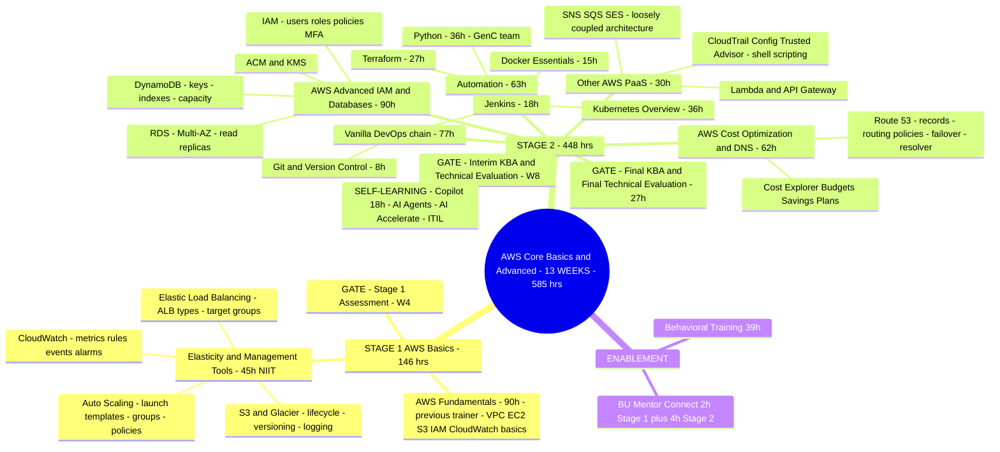

# Syllabus 2 — AWS Core: Basics and Advanced — Standard (13 WEEKS, NIIT)

> Source: `AWS Core - Basics and Advanced - Standard Timetable - NIIT Trainer.xlsx`
> Track: AWS Core — Basics and Advanced | Audience: PT\PAT (Night support for DevOps role)
> Gate: **"A" GREEN as PHS in Final Evaluation**
> Total: **585 hrs / 65 days / 13 weeks**
> Calendar: live timetable runs **W3 → W11 (5 Oct 2026 → 3 Dec 2026, 44 session days)**; AWS Fundamentals (90h) was handled earlier by a previous trainer.

---

## 1. Overall Shape (mermaid mindmap)

---

## 2. Learning Sequence — module-wise flow

**Module-wise logic (why the order):**
1. **Elasticity & Management Tools** (W3, 5 days) — Auto Scaling (launch configs/templates, scaling policies, lifecycle) → ELB (types, request routing, target groups) → CloudWatch (metrics/rules/events/alarms) → S3 + Glacier (lifecycle, versioning, logging). Labs 5–6: ASG behind ALB; S3 lifecycle.
2. **Stage 1 Assessment** Day 6 (W4) — 1 hr doubt-clarification + rest of day with HiPo batch.
3. **Cost Optimization & DNS** (62h) — billing first (Cost Explorer, budgets, tags; Savings Plans/RI strategy), then Route 53 (record types A/CNAME/MX/TXT/PTR → routing policies Simple/Weighted/Latency/Failover/Geo/Multivalue → domain registration/transfer → alias integration with EC2/S3/CloudFront/ELB/Global Accelerator → health checks & failover → private hosted zones & Route 53 Resolver/VPC DNS/hybrid/forwarding). Labs 8–10.
4. **AWS Advanced — IAM & Database Services** (90h) — IAM users/groups, authn vs authz → roles/policies (identity vs resource-based) → best practices + MFA → ACM/KMS (keys, encryption, rotation) → RDS (engines, storage, SGs, parameter/option groups, backups, Multi-AZ, read replicas) → DynamoDB (data model, partition/sort keys, operations, secondary indexes, capacity modes) → consolidation lab (RDS + DynamoDB behind a secured app tier). Labs 11/13.
5. **Automation** — Terraform (27h): intro/install/providers/HCL → resources/variables/outputs/data sources, state & lifecycle (plan/apply/destroy) → modules, remote state (S3 backend + DynamoDB lock), workspaces, best practices. Python (36h) handled by GenC team in parallel.
6. **Interim gate** (W8): Interim KBA (MCQ) + Interim Technical Evaluation (9h).
7. **Other AWS PaaS** (30h) — SNS/SQS/SES & loosely coupled architecture (Lab 15) → Lambda + API Gateway event-driven/serverless (Lab 16) → CloudTrail/Config/Trusted Advisor governance + shell-script basics driving AWS CLI.
8. **Vanilla DevOps chain** — Git basics (init/add/commit/status/log, branching & merging, Lab 17) → Jenkins (intro/architecture, install, dashboard, config, first freestyle job w/ Git, triggers manual/SCM polling/webhooks/cron → pipeline types Freestyle/Declarative/Scripted/Multibranch, Pipeline as Code, tool integration GitHub/Slack/email/artifact repos, build management, Lab 18 declarative Jenkinsfile) → Docker Essentials (intro, containers vs VMs, install, images & containers, Dockerfile; build/manage images, run/start/stop/restart, Docker Hub & ECR push/pull, image scanning; Labs 19) → Kubernetes Overview (basics & architecture: nodes/pods/deployments/services; run simple pod & service; scaling & updates; exposing via ClusterIP/NodePort/LoadBalancer; PVs & PVCs; canary with horizontal scaling; Labs 20–21).
9. Self-learning: Copilot (18h), AI Agents, AI Accelerate (GenAI fundamentals, Responsible AI, Flowsource, Context Engineering), ITIL.
10. **Final gate**: Final KBA (MCQ) + Final Technical Evaluation (27h).

**"Come back to it" points:** Python appears in Stage 2 Automation (36h) — built on general Python basics assumed from common program level; shell scripting returns inside PaaS module (day 31: shell scripts driving AWS CLI); Terraform after IAM/RDS because modules provision VPC+EC2 with security and then remote state uses S3+DynamoDB (skills from module 4).

---

## 3. Day-by-day trainer timetable (NIIT Standard batch — the true order)

| Day | Date | Week | Module |
|-----|------|------|--------|
| 1 | 05 Oct | W3 | Stage 1: Elasticity — Auto Scaling concepts, launch templates/groups |
| 2 | 06 Oct | W3 | Scaling policies (target tracking, step, scheduled) — Lab 5 pt 1 |
| 3 | 07 Oct | W3 | ELB — load balancer types, request routing, target groups — Lab 5 pt 2 |
| 4 | 08 Oct | W3 | CloudWatch metrics/rules/events/alarms driving scaling |
| 5 | 09 Oct | W3 | S3 & Glacier; lifecycle, versioning, logging — Lab 6 |
| 6 | 12 Oct | W4 | **Stage 1 Assessment day** |
| 7–13 | 13–21 Oct | W4–W5 | Cost Optimization (Expl./Budgets/Savings) then Route 53 (records, policies, integration, failover/resolver) — Labs 8–10 |
| 14–23 | 22 Oct – 04 Nov | W5–W7 | AWS Advanced: IAM & DB — IAM/roles/MFA, ACM/KMS, RDS, DynamoDB, consolidation — Labs 11/13 |
| 24–26 | 05–09 Nov | W7–W8 | Terraform — init → resources/variables → modules/remote state |
| 27 | 10 Nov | — | Holiday |
| 28 | 12 Nov | W8 | **Interim KBA (MCQ) + Interim Technical Evaluation (9h GenC)** |
| 29–31 | 13–18 Nov | W8–W9 | Other PaaS: SNS/SQS/SES, Lambda+API GW, CloudTrail/Config/TA + shell scripts — Labs 15–16 |
| 32 | 19 Nov | W9 | Git & version control — Lab 17 |
| 33–34 | 19–20 Nov | W9 | Jenkins — install/freestyle/triggers, then pipeline types + Jenkinsfile — Lab 18 |
| 35–36 | 23–24 Nov | W9–W10 | Docker Essentials — Labs 19 |
| 37–38 | 25–26 Nov | W10 | Kubernetes Overview — Labs 20–21 |
| 39–41 | 27 Nov – 01 Dec | W10–W11 | GenAI/Copilot/Context Engineering sessions + doubt clarification (GenC + NIIT) |
| 42–44 | 02–03 Dec | W11 | **Final KBA + Final Technical Evaluation** |

## 4. TOC_Stage1 / TOC_Stage2 lab map

- **Stage 1 (AWS Basics)**: Lab 1 Launch first EC2 (SSH, EBS attach) · Lab 2 VPC & subnets (route tables) · Lab 3 VPC Peering & TGW · Lab 5 ASG + ALB · Lab 6 S3 lifecycle.
- **Stage 2**: Lab 8 Cost Explorer & Budgets · Lab 9 Route 53 records · Lab 10 failover/health checks · Lab 11 IAM users/roles/MFA · Lab 13 RDS secure · Labs 15–16 SNS/SQS/SES & Lambda · Lab 17 Git · Lab 18 Jenkins pipeline · Lab 19 Docker web app · Lab 20 K8s canary + PV/PVC · Lab 21 K8s web app.

## 5. Performance outcomes (sub-tracks)
AWS Basics — Fundamentals (Skill) · AWS Basics — Elasticity & Mgmt Tools (Skill) · Cost Optimization & DNS (Skill — UKA architectural compliance / reduce cloud waste) · AWS Advanced IAM & Databases (Skill) · Other PaaS IAM-heavy outcomes (Skill) · Git (Skill) · Ansible for automation (listed in outcome sheet — appears in tracker only) · Docker Essentials (Skill) · Kubernetes (Skill) · Automation Python + Terraform (Skill).

## 6. Notes coverage — revise with

| Module | Notes in repo |
|---|---|
| AWS Fundamentals (VPC, EC2, S3, IAM, CloudWatch…) | `AWS_notes/AWS_Notes_Analysis.md` + `data/AWS_Notes_Transcription.md` shelf pages 1–43 (Cloud Practitioner: modules 1–10) |
| Elasticity, ELB, ASG, CloudWatch deep | `AWS_notes/Notes.pdf` transcription — shelf pages 44–61 (CIDR, CloudWatch, ALB/NLB/GLB, EventBridge, VPC components) |
| DNS/Route 53 concepts | Pavan pages 12–18 (DNS structure/lookup/caching/TTL) as conceptual base |
| SNS→EventBridge | `AWS_notes/event bridge.pdf` transcription — shelf pages 62–64 |
| Git/Jenkins/Docker/K8s/Terraform | `azure/DevOps_Notes_Analysis.md` shelf pages: GitHub 42–51, Jenkins 52–91, Terraform 111–131 and 17–41 Docker & Kubernetes (concepts shared), plus `data/Azure_Notes_Transcription.md` same pages |
| Python | Pavan notes pages 8–12 (bash/users/groups) + Stage-2 A&A Python notes if applicable |

Missing from notes: Route 53 deep detail, KMS/ACM, DynamoDB detail, AWS Cost tools, EKS/ECS, Kubernetes deep lab details partially covered by DKR notes pages 10–25.
