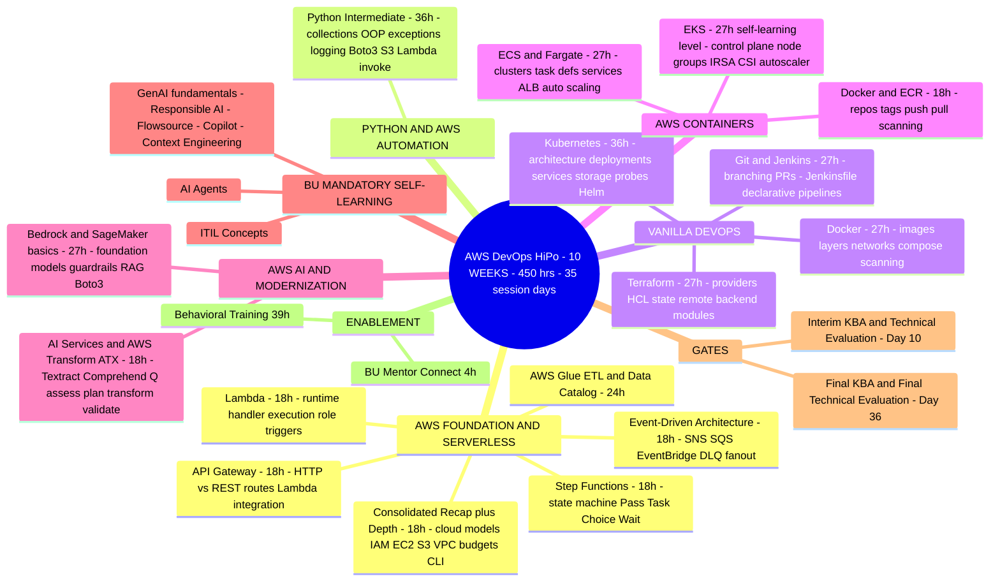

# Syllabus 3 — CIS AWS DevOps HiPo Curriculum (10 WEEKS, NIIT)

> Source: `CIS - AWS Devops  - HiPo Curriculum - 10 WEEKS - NIIT Trainer.xlsx`
> Track: AWS DevOps (HiPo) | Audience: PT\PAT accelerated batch
> Total: **450 hrs / 50 days / 10 weeks**
> Context: Stage-1 basics were covered in the first 10 days by an earlier trainer; the NIIT trainer re-covers them as a **2-day consolidated recap + depth**. HiPo finishes 5 days before Standard (ends 23 Nov vs 30 Nov).

---

## 1. Overall Shape (mermaid mindmap)

---

## 2. Learning Sequence — module-wise flow

```mermaid
flowchart LR
  A[Day 1 to 2 - Consolidated recap of AWS Foundation Serverless depth] --> B[Day 3 to 6 - Python for AWS Automation]
  B --> C[Day 7 to 9 - Terraform]
  C --> I1{{INTERIM KBA + Technical Evaluation - Day 10}}
  I1 --> D[Day 11 to 13 - Git and Jenkins]
  D --> E[Day 14 to 16 - Docker]
  E --> F[Day 17 to 20 - Kubernetes]
  F --> G[Day 21 to 22 - Containers on AWS Docker and ECR]
  G --> H[Day 23 to 25 - ECS and Fargate]
  H --> H2[Day 26 to 29 - EKS]
  H2 --> I[Day 30 to 32 - Bedrock and SageMaker]
  I --> J[Day 33 to 34 - AI Services and AWS Transform]
  J --> K[Day 35 - BU mandatory sessions GenC]
  K --> F1{{FINAL KBA + Final Technical Evaluation}}
```

**Module-wise logic (build order):**
1. **Recap + depth** (2 days): cloud models, Regions/AZs/edge, service models, shared responsibility, IAM users/groups/roles/policies, EC2/S3/VPC/CloudWatch, Free Tier/budgets/billing alerts. Lab: AWS CLI + `sts get-caller-identity`; budget alert + console tour.
2. **Event-Driven mini flow** (Day 2): SQS standard queue lifecycle, SNS topics/fan-out, EventBridge bus/rule/target, DLQ. End-to-end lab: API GW → Lambda → SNS → SQS orchestrated by Step Functions Choice workflow → CloudWatch verify.
3. **Python for AWS Automation — Intermediate** (4 days, 36h): fundamentals → collections → control flow/functions → modules/pip/virtualenv → file & JSON handling → OOP → exceptions → logging → **Boto3** (client vs resource, region, creds) → S3 automation → Lambda invoke — Lab 19 (JSON processing script) + Lab 20 (Boto3 S3 + Lambda invoke).
4. **Terraform** (3 days): IaC concepts, Terraform vs CloudFormation → init/validate/plan/apply/destroy → providers/HCL/resources → variables, locals, outputs, data sources, count & for_each → **state management: S3 remote backend + DynamoDB locking, modules, workspaces, lifecycle rules, import**.
5. **Interim gate** (Day 10).
6. **Git & Jenkins** (3 days): version control, branching/merging, conflicts, remotes/PRs, .gitignore, tags → CI/CD concepts, Jenkins architecture (controller/agents), creds/plugins/triggers, freestyle vs pipeline → declarative Jenkinsfile (stages, post, parameters), shared libraries, artifact archiving, notifications.
7. **Docker** (3 days): containers vs VMs, daemon architecture, images/layers, registries, run/ps/stop/rm, ports/logs/exec → Dockerfile instructions (FROM/COPY/RUN/EXPOSE/CMD vs ENTRYPOINT), multi-stage builds, hygiene → volumes/bind mounts, networks (bridge/host/user-defined), env vars, **Docker Compose**, repositories, image scanning.
8. **Kubernetes** (4 days): architecture (control plane, etcd, scheduler, kubelet, kube-proxy), minikube/kind, kubectl, pods/namespaces → ReplicaSets/Deployments, rolling updates/rollbacks, labels/selectors, resource requests/limits → Services (ClusterIP/NodePort/LoadBalancer), Ingress, ConfigMaps/Secrets → storage (PV/PVC/StorageClass), StatefulSets/DaemonSets, liveness/readiness probes, **Helm**, troubleshooting.
9. **Containers on AWS** (2 days): image/container/registry on AWS, ECR repos/tags/push/pull, get-login-password auth, lifecycle policies, scanning — Labs 13–14.
10. **ECS & Fargate** (3 days): cluster/task definition/task/service, Fargate vs EC2 launch type, task-def fields, networking (subnets, SGs, container port), task role vs execution role, CloudWatch container logs → desired count, ALB target group integration, service auto scaling, deployment types, cost cleanup — Labs 15–16.
11. **EKS** (3 days, knowledge level): AWS-managed control plane, managed node groups vs Fargate profiles, IAM/aws-auth, kubeconfig → kubectl against EKS, LoadBalancer service via AWS Load Balancer Controller, Ingress → ConfigMap/Secret on EKS, **IRSA**, EBS CSI storage, cluster autoscaler/Karpenter, control-plane logging — Labs 17–18 (EKS wizard walkthrough cancel-first; cost safety: no EKS in personal free account).
12. **AWS AI & Modernization** (3 days): AI/ML stack naming/positioning → Bedrock (models, model access, prompts, inference params, knowledge bases/RAG, agents, **guardrails**, Boto3 `invoke_model`) → SageMaker (Studio, notebooks, built-in algorithms, training jobs, model registry, endpoints) → AI services (Textract, Comprehend, Transcribe, Polly, Translate, Rekognition), Amazon Q, service selection → **AWS Transform (ATX)**: assess/plan/transform/validate plan for a legacy app; responsible AI wrap-up.
13. **BU Mandatory + final gate**: GenAI/Copilot/Flowsource/Context Engineering sessions (GenC, Day 35) → Final KBA + Final Technical Evaluation.

**"Come back to it" points:** Python learned here (day 3–6) is immediately reused in Boto3 automation and again in Bedrock `invoke_model` (day 31). Kubernetes (days 17–20) is the prerequisite that gets re-applied from ECS→EKS. Docker→ECR→ECS→EKS is one continuous containers story.

---

## 3. Curriculum-Tracker module list (135h cost-tracked version — the topics source)

| # | Category | Module | Hrs | Key labs |
|---|----------|--------|-----|----------|
| 1 | AWS & Cloud Foundation | AWS Foundational Discussion | 8 | L1 CLI/identity, L2 budget |
| 2 | AWS Application Integration | Event-Driven Arch — SNS, SQS, EventBridge | 24 | L3 SQS, L4 SNS fan-out |
| 3 | AWS Serverless | Amazon API Gateway | 16 | L5 Lambda+HTTP API, L6 test via curl |
| 4 | AWS Serverless | AWS Lambda | 24 | L7 Python hello Lambda, L8 S3 trigger |
| 5 | AWS Serverless | AWS Step Functions | 24 | L9 Pass+Choice machine, L10 Lambda+Retry/Catch |
| 6 | AWS Data Services | AWS Glue — ETL & Data Catalog | 24 | L11 catalog table, L12 Glue Studio draft |
| 7 | AWS Containers | Containers on AWS — Docker & ECR | 16 | L13 Nginx run, L14 build+push ECR |
| 8 | AWS Containers | Amazon ECS & AWS Fargate | 24 | L15 cluster/task-def, L16 Docker→ECS mapping |
| 9 | AWS Containers | Amazon EKS & Kubernetes on AWS | 24 | L17 Nginx+service on EKS, L18 wizard walk-through |
| 10 | AWS AI & Modernization | AWS AI Services & AWS Transform Basics | 16 | Textract + Comprehend demo |
| 11 | Python & AWS Automation | Python for AWS Automation — Intermediate | 32 | L19 JSON script, L20 Boto3 S3/Lambda |

## 4. Gating + assessments
- Stage 2-only track (after prior 10-day basics): Interim KBA (MCQ) 1h + Interim Technical Evaluation 9h → Final KBA 1h + Final Technical Evaluation 18h.
- 18h Bedrock/SageMaker + EKS segment marked self-learning/knowledge level in sheet but timed live in timetable.

## 5. Notes coverage — revise with

| HiPo module | Notes in repo |
|---|---|
| Foundation recap | `AWS_notes/` Cloud Practitioner transcription (shelf 1–43) — EC2, VPC, S3, IAM, CloudWatch |
| Event-driven SNS/SQS/EventBridge | `AWS_notes/event bridge.pdf` transcription (shelf 62–64) + Notes.pdf SQS/SNS coverage (shelf 44–61) |
| Lambda / API Gateway / Step Functions | Cloud Practitioner pages 8–10 (serverless), CNAIP Module 2 lists mirror this |
| Docker / ECR / ECS / EKS | `azure/Docker & Kubernetes (1).pdf` transcription (shelf 17–41) — Dockerfile, ECS labs, layering |
| Git | `azure/GITHUB.pdf` transcription (shelf 42–51) |
| Jenkins | `azure/JENKINS.pdf` transcription (shelf 52–91) |
| Terraform | `azure/TERRAFORM .pdf` transcription (shelf 111–131) |
| Bedrock/RAG/RAGAS/vector concepts | Pavan pages 66–82 (prompt eng → LangChain → RAG → vector DBs) |
| Python/Boto3 | Pavan pages 45–60 (scripting, REST, Terraform) — Boto3 itself MISSING from notes |

Missing from notes: Glue/Data Catalog, Step Functions detail, ECS/EKS specifics, Bedrock/SageMaker, AWS Transform.
