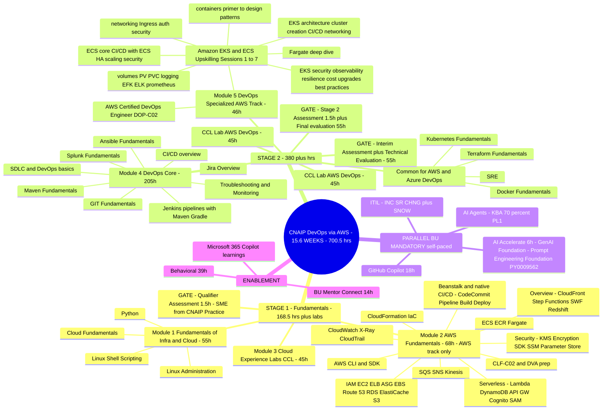

# Syllabus 4 — CIS CNAIP: DevOps via AWS (15.6 WEEKS)

> Source: `CIS - CNAIP - DevOps via AWS_v2_Curriculum - 15.6 WEEKS.xlsx`
> Track: CIS Cloud Native App Infra & Platforms — DevOps via AWS Core
> Audience: PT\PAT | Gate: **"A" GREEN as PHS in Final Evaluation**
> Total: **700.5 hrs / 77.8 days / 15.57 weeks** (the longest of the four)
> Labs: **CCL (Cognizant Cloud Labs)** — Stage 1 timed labs, Stage 2 timed + persistent labs (book 3 days ahead via IIHT POC)

---

## 1. Overall Shape (mermaid mindmap)

---

## 2. Learning Sequence — module-wise flow

```mermaid
flowchart LR
  M1[Module 1 - Linux Python Shell Scripting Cloud Fundamentals 55h] --> M2[Module 2 - AWS Fundamentals 68h]
  M2 --> M3[Module 3 - Cloud Experience Labs CCL 45h]
  M3 --> G1{{Qualifier Assessment - 1.5h}}
  G1 --> M4[Module 4 - DevOps Core 205h]
  M4 --> SPC[Terraform - Docker - K8s - SRE]
  SPC --> I1{{Interim Assessment + Interim Technical Evaluation}}
  I1 --> M5[Module 5 - DevOps Specialized - EKS ECS Fargate DOP-C02 46h]
  M5 --> L1[CCL Lab AWS DevOps 45h]
  L1 --> F1{{Stage 2 Assessment + Final Evaluation - 55h}}
```

**Module-wise logic (build order):**
1. **Module 1 (55h)** — foundation tools ON the OS first: Linux Administration (bootcamp ILT), Python, Linux Shell Scripting, Cloud Fundamentals. Nothing AWS yet — this is the OS/scripting layer.
2. **Module 2 (68h)** — whole AWS surface in one sweep, ordered: IAM/EC2/ELB/ASG → EBS/Route 53/RDS/ElastiCache/S3 → CLI/SDK → deploy via Beanstalk & native CI/CD services (CodeCommit/CodePipeline/CodeBuild/CodeDeploy) → CloudFormation IaC → observability/audit (CloudWatch/X-Ray/CloudTrail) → integration/messaging (SQS/SNS/Kinesis) → serverless (Lambda/DynamoDB/API Gateway/Cognito/SAM) → containers in AWS (ECS/ECR/Fargate) → security best practices (KMS/Encryption SDK/SSM Parameter Store/IAM policies) → misc overview (CloudFront/Step Functions/SWF/Redshift). Maps to **CLF-C02 + DVA-C02** certification prep.
3. **Module 3 (45h)** — CCL hands-on use cases on everything above → **Qualifier Assessment (SME, CNAIP Practice)** gates Stage 2.
4. **Module 4 DevOps Core (205h)** — the classic DevOps toolchain ILT block: SDLC/DevOps basics → CI/CD overview → **Jenkins** (fundamentals + fully automated build-to-deploy + build/deploy/test) → **Ansible** → **GIT** → **Maven** (quick start; plus Gradle via the DevOps CI/CD course) → **Jira** (users, managers, admins) → **Splunk** (beginner + beginner-to-architect) →Troubleshooting basics / Advanced troubleshooting & tools / Monitoring the health of your application.
5. **Common specialized (AWS + Azure DevOps)** — Terraform (Building Cloud Infrastructure) → Docker (essentials → absolute beginner → DCA) → Kubernetes (complete course + CKA prep) → SRE (Big Picture + 101 automation).
6. **Interim gate** — interim assessment + **Interim Technical Evaluation (55h weight, SME)**.
7. **Module 5 DevOps Specialized (46h)** — AWS container platform deep dive: **Amazon EKS & ECS Upskilling Program sessions 1–7** (containers primer/design patterns → storage/logging/monitoring → networking/auth → EKS cluster creation/CI-CD → EKS security/observability → resilience/cost/upgrades → ECS core/CI-CD/HA/scaling/best practices) + Fargate deep-dive + **AWS Certified DevOps Engineer Professional (DOP-C02)** course.
8. **CCL Lab AWS DevOps** (both stages, 45h each) → Stage 2 Assessment (1.5h) + **Final Evaluation (55h, SME)**.
9. Parallel (own pace, must finish within training): AI Accelerate (6h: GenAI fundamentals ELRNG01863 + quick assessment; Responsible AI intro CGZ-914en + deep-dive; **Prompt Engineering Foundation PY0009562** with lab), GitHub Copilot (18h, incl. M365 Copilot learning paths), AI Agents (PY0010995, KBA ≥70% → PL1), ITIL (ITIL 4 udemy set + ServiceNow ITSM + K-point recordings + 90-min SME session).

**"Come back to it" points:**
- Linux/Python/shell (Module 1) are revisited implicitly in every lab: Jenkins agents, Ansible inventory, Dockerfiles, kubectl, Boto3-style automation.
- Module 2 services (VPC, IAM, ECR, EKS basics, CloudFormation) are the raw material for Module 4/5 tooling — e.g., Terraform replaces beat CloudFormation approach from Module 2; EKS Section 5 goes deeper than Module 2's ECS/ECR/Fargate preview.
- DOP-C02 ties Module 2 (services) + Module 4 (CI/CD) + Module 5 (containers) together — it's the capstone certification of the track.

---

## 3. Stage-2 core-modules detail cards

**Jenkins (largest single ILT thread)** — Jenkins 2 Bootcamp (fully automate builds to deployment) + Working with Jenkins (build+deploy+test) + DevOps CI/CD with Jenkins pipelines/Maven/Gradle.
**Ansible** — Mastering Ansible; deploy Python web app with Ansible; manage infra on AWS/Azure; Tower/Galaxy advanced features; config-management tasks.
**Git** — Git Complete step-by-step.
**Maven** — Maven Quick Start by example.
**Jira** — Introduction to Jira + Complete guide with Confluence.
**Splunk** — The Complete Splunk Beginner Course + Splunk Beginner-to-Architect.
**Kubernetes** — Learn DevOps: Complete Kubernetes Course + CKA with practice tests.
**Terraform** — Building Cloud Infrastructure with Terraform.
**SRE** — SRE Big Picture + SRE & Automation 101.

## 4. Software / lab requirements (from sheet)
- Stage 1: CCL Timed Lab · Stage 2: CCL Timed + Persistent Lab access.
- GitHub Copilot license for AI Agent/Copilot work · coach must request lab access from IIHT POC (ID 905209) 3 days before training starts.

## 5. Performance outcome themes (sub-tracks)
AWS Basics & Fundamentals (Skill) · AWS DevOps & Cloud Basics (Skill) · DevOps Core Modules (Skill) · DevOps Specialization AWS DevOps (Skill — Ansible-heavy wording: deploy Python web app, manage AWS/Azure infra with Ansible, Tower/Galaxy) · certification targets CLF-C02/DVA-C02 (Stage 1) and DOP-C02 (Stage 2).

## 6. Notes coverage — revise with

| CNAIP module | Notes in repo |
|---|---|
| Module 1 Linux/Python/Shell | Pavan pages 5–12 (Windows/Linux, users/groups, chmod, bash) — Linux Admin detail partially MISSING |
| Module 2 AWS Fundamentals | `AWS_notes/` Cloud Practitioner transcription (shelf 1–43) covers most topics; ElastiCache/Cognito/SAM/Kinesis XaaS detail MISSING |
| Module 4 Jenkins | `azure/JENKINS.pdf` transcription (shelf 52–91) — 40 pages, matches well |
| Module 4 GIT | `azure/GITHUB.pdf` transcription (shelf 42–51) |
| Module 4 Maven | `azure/MAVEN.pdf` transcription (shelf 92–110) |
| Module 4 Ansible | `azure/ANSIBLE.pdf` transcription (shelf 1–16) |
| Module 4 Splunk | `azure/SPLUNK(2).pdf` transcription (shelf 132) |
| Common: Terraform/Docker/K8s | `azure/TERRAFORM .pdf` (shelf 111–131) + `azure/Docker & Kubernetes (1).pdf` (shelf 17–41) |
| Module 5 EKS/ECS | DKR notes pages 10–25 (ECS labs, storage drivers) — EKS-specific depth MISSING |
| Jira / SRE / DOP-C02 | MISSING from notes |
